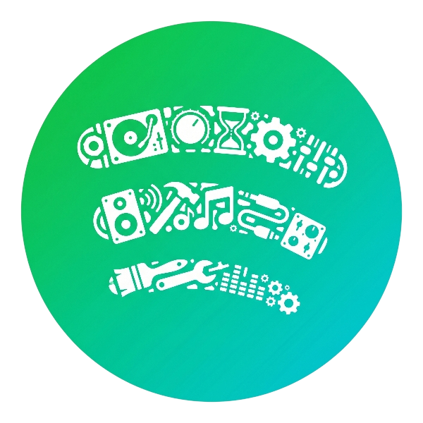
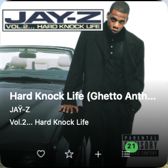
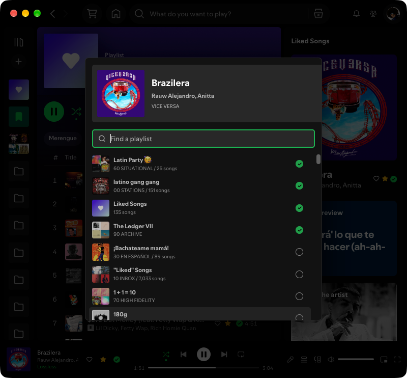
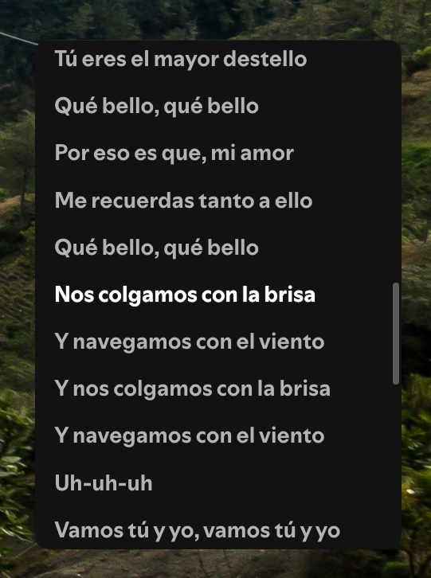
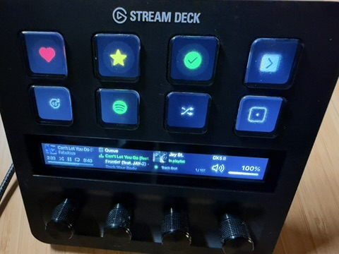

<div align="center">
  

  <h1>SpotiFi</h1>

  <p><strong>HiFi UX enhancements for Spotify.</strong></p>

  <p>
    <a href="https://www.spotify.com/"></a>
    <a href="https://spicetify.app/"></a>
    <a href="https://www.elgato.com/us/en/p/stream-deck"></a>
  </p>
</div>

---

## Contents

- [Features](#features)
  - [Love and Like](#love-and-like)
  - [Mini Player](#mini-player)
  - [Add to Playlist Overlay](#add-to-playlist-overlay)
  - [Lyrics Viewer](#lyrics-viewer)
  - [Stream Deck](#stream-deck)
- [Quick start](#quick-start)
- [Commands](#commands)
- [License](#license)

## Features

SpotiFi brings an assortment of features and controls that will have you questioning Spotify's priorities. 🤭

### Love and Like

Love a song? Adds to your Loved Songs playlist.

Like a song? Stars and adds to your Liked Songs playlist.

Song already in a playlist? Plus / green checkmark, click to see/choose where.


### Mini Player

A resizable, square macOS player with artwork, metadata, curation controls, and global shortcuts.



### Add to Playlist Overlay

A searchable playlist overlay for tracks and albums.



### Lyrics Viewer

Standalone window for live lyrics.



### Stream Deck

Dedicated page of controls.



## Quick start

On macOS, install [Homebrew](https://brew.sh/) and run:

```sh
brew install just node uv
xcode-select --install  # if Xcode Command Line Tools are not installed
uv sync --extra dev
just dependencies
open -a Spotify         # sign in before continuing
just configure
```

## Commands

| Task | Purpose |
| --- | --- |
| `just configure` | Reconcile the complete supported setup |
| `just dependencies` | Install missing Spotify and Spicetify dependencies |
| `just spotify` | Reconcile managed Spotify extensions |
| `just mini` | Reconcile the native companion and login startup |
| `just streamdeck` | Reconcile an installed Stream Deck app's plugin and controls page |
| `just plan` | Preview Stream Deck changes without writing them |
| `just test` | Run JavaScript and Python tests |
| `just test-mini` | Build and check the native companion and HTTP bridge |
| `just lint` | Check Python lint and formatting |
| `just check` | Run lint, formatting, and regression tests |
| `just build` | Build a source archive and an installable wheel |

The CLI is available at `bin/spotifi`:

```sh
bin/spotifi play
bin/spotifi play liked --shuffle
bin/spotifi play 180g --smart-shuffle
bin/spotifi mini status
bin/spotifi mini stop
bin/spotifi apply       # explicitly reapply and reload the companion
bin/spotifi update      # explicitly update and reconcile
```

## License

[MIT](LICENSE)

Spotify, Elgato, Stream Deck, and related names and logos are trademarks or registered trademarks of their respective owners. References to these products are for identification only and do not imply affiliation with or endorsement by their owners.
