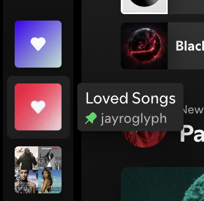

<div align="center">
  

  <h1>SpotiFi</h1>

  <p><strong>HiFi UX enhancements for Spotify.</strong></p>

  <p>
    <a href="https://www.spotify.com/"></a>
    <a href="https://spicetify.app/"></a>
    <a href="https://www.elgato.com/us/en/p/stream-deck"></a>
  </p>
</div>

---

## Contents

- [Features](#features)
  - [Love and Like](#love-and-like)
  - [Mini Player](#mini-player)
  - [Add to Playlist Overlay](#add-to-playlist-overlay)
  - [Lyrics Viewer](#lyrics-viewer)
  - [Stream Deck](#stream-deck)
- [Quick start](#quick-start)
- [Commands](#commands)
- [License](#license)

## Features

SpotiFi brings an assortment of features and controls that will have you questioning Spotify's priorities. 🤭

### Love and Like

Love a song? Adds to your Loved Songs playlist.

Like a song? Stars and adds to your Liked Songs playlist.

The adjacent Spotify control keeps its native add and playlist-menu behavior.

The X below the playing track's add button marks it for removal from the playing playlist when the track changes. Click again to cancel. In supported personalized playlists, it hides the track in that playlist instead; the control is hidden where neither action is available.


### Mini Player

A resizable, square macOS player with artwork, metadata, curation controls, and global shortcuts.


### Add to Playlist Overlay

A searchable playlist overlay for tracks and albums.


### Lyrics Viewer

Standalone window for live lyrics.


### Stream Deck

Dedicated page of controls.


# Episodes Begone

I don't care about podcasts, Spotify. I **just** want music. The fact that Your Episodes is immutable is infuriating. We address that by hiding the item altogether.



## Quick start

On macOS, install [Homebrew](https://brew.sh/) and run:

```sh
brew install just node uv
xcode-select --install  # if Xcode Command Line Tools are not installed
uv sync --extra dev
just configure          # installs missing dependencies
open -a Spotify         # sign in, then run just configure again
```

## Commands

| Command | Purpose |
| --- | --- |
| `just configure` | Reconcile dependencies, Spotify, the mini player and an installed Stream Deck |
| `just check` | Show differences between installed Spotify/Spicetify and the defined modules; returns zero when differences are found; nonzero if inspection fails |
| `make check` | Run lint, formatting checks and regression tests |
| `make fmt` | Format and fix Python code |
| `make lint`, `make test` | Run individual maintenance checks |
| `make build` | Build a source archive and wheel |
| `make build-mini`, `make test-mini` | Build and test the macOS companion |

Enhancement modules live in `modules/`; `modules/manifest.json` defines their extension files and load order. `just check` reports missing or retired extensions, configuration paths, bundle wiring and file diffs without changing the installation.

The CLI is available at `bin/spotifi`:

```sh
bin/spotifi play
bin/spotifi play liked --shuffle
bin/spotifi play 180g --smart-shuffle
bin/spotifi mini status
bin/spotifi mini stop
bin/spotifi apply       # explicitly reapply and reload the companion
bin/spotifi update      # explicitly update and reconcile
```

## License

[MIT](LICENSE)

Spotify, Elgato, Stream Deck, and related names and logos are trademarks or registered trademarks of their respective owners. References to these products are for identification only and do not imply affiliation with or endorsement by their owners.
